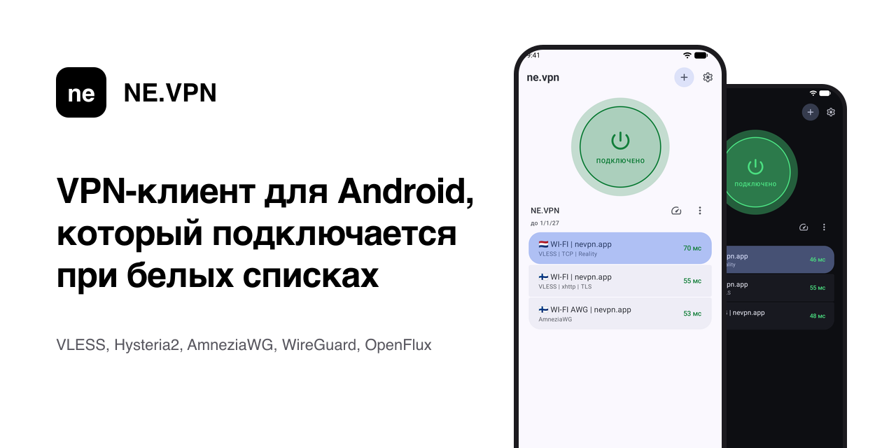
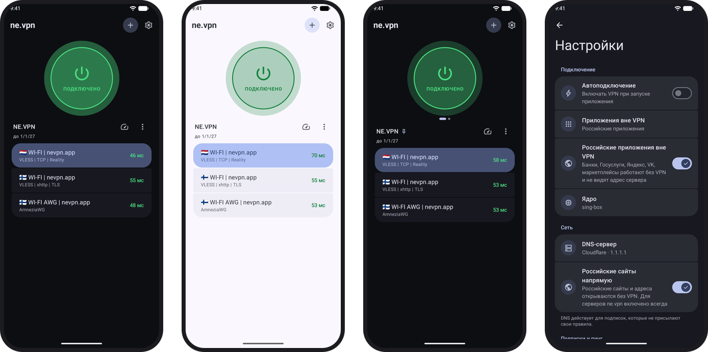
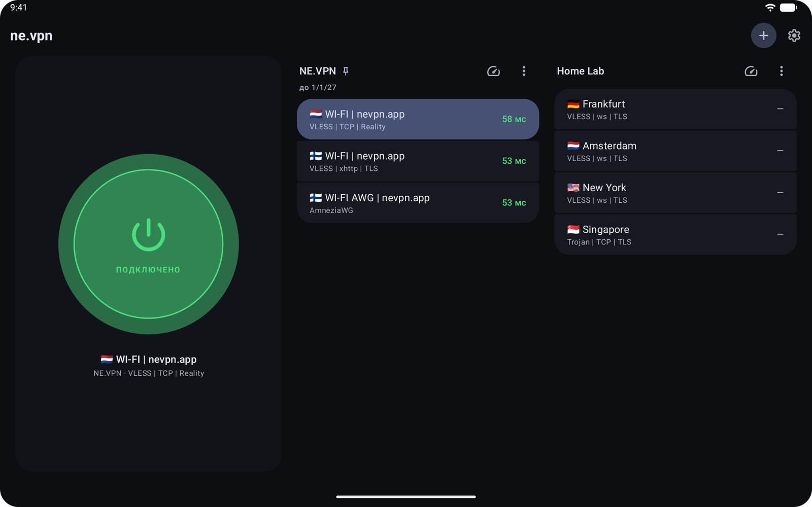

<a href="https://nevpn.app">
  <picture>
    <source media="(prefers-color-scheme: dark)" srcset="assets/banner-dark.png">
    
  </picture>
</a>

<p align="center">
  <a href="https://github.com/FijshH/nevpn-releases/releases/latest"></a>
  <a href="https://github.com/FijshH/nevpn-releases/releases"></a>
  
  <a href="https://nevpn.app"></a>
</p>

<p align="center">
  <a href="https://github.com/FijshH/nevpn-releases/releases/latest"><b>Скачать APK</b></a>
  &nbsp;&nbsp;·&nbsp;&nbsp;
  <a href="https://nevpn.app">Сайт</a>
  &nbsp;&nbsp;·&nbsp;&nbsp;
  <a href="#english">English</a>
</p>

**NE.VPN** — бесплатный VPN-клиент для Android. Одна кнопка, подписки любых провайдеров и поддержка OpenFlux, который подключается, когда мобильный интернет на белых списках и обычный VPN не работает. Здесь лежат все версии приложения; новые приложение находит и ставит само.

<p align="center">
  
</p>

## Возможности

- **Белые списки.** Когда оператор пропускает только разрешённые сайты, обычный VPN не подключается. NE.VPN умеет OpenFlux: добавьте ссылку `openflux://` провайдера или своего сервера, и если прямой путь закрыт, канал сам перейдёт на запасной.
- **Любая подписка.** Ссылка-подписка любого провайдера, отдельные ссылки, ключ Amnezia `vpn://` или файл `.conf`. Подписок сколько угодно, между ними — свайп.
- **Протоколы:** VLESS (Reality, XHTTP, WS, gRPC), VMess, Trojan, Shadowsocks, Hysteria2, TUIC, AnyTLS, AmneziaWG до 3.1, WireGuard, OpenFlux.
- **Два ядра.** sing-box по умолчанию, Xray-core — переключателем в настройках.
- **Россия мимо VPN.** Банки, Госуслуги, Яндекс, VK и маркетплейсы работают напрямую и не видят адрес сервера. Список приложений можно поменять.
- **Пинг до каждого сервера** ещё до подключения: ICMP или время TCP-соединения.
- **Обновляется само.** О новой версии приходит уведомление; если сервер обновлений закрыт, приложение скачает её через VPN.
- **Плитка в шторке, постоянная VPN и автоподключение.**
- **Планшеты и раскладные телефоны:** кнопка слева, подписки справа, по несколько в ряд.

<p align="center">
  
</p>

## Установка

1. Откройте [последний релиз](https://github.com/FijshH/nevpn-releases/releases/latest) и скачайте APK (какой — в таблице ниже).
2. Откройте файл. Android попросит разрешить установку из браузера — разрешите один раз.
3. В приложении нажмите **+** и вставьте ссылку-подписку, отдельные ссылки или ключ.
4. Нажмите кнопку подключения. Android один раз спросит разрешение на VPN.

Root не нужен. Нужен Android 8.0 или новее.

### Какой APK выбрать

| Файл | Для чего |
|---|---|
| `nevpn-<версия>-arm64-v8a.apk` | Почти все телефоны и планшеты последних лет. Если не знаете — берите этот |
| `nevpn-<версия>-armeabi-v7a.apk` | Старые 32-битные телефоны |
| `nevpn-<версия>-x86_64.apk` | Эмуляторы и устройства на Intel/AMD |
| `nevpn-<версия>.apk` | Универсальный: подходит всем, но весит втрое больше |

### Проверка файла

Все версии подписаны одним ключом, поэтому Android не поставит поверх приложения APK с другой подписью. Контрольные суммы SHA-256 каждого файла лежат в `update.json` релиза и на [nevpn.app](https://nevpn.app):

```bash
shasum -a 256 nevpn-*.apk
```

## Вопросы

<details>
<summary><b>Приложение бесплатное?</b></summary>
<br>
Да. Это клиент: он подключается к серверам вашей подписки — от провайдера или своего сервера.
</details>

<details>
<summary><b>Почему не в Google Play?</b></summary>
<br>
Приложение распространяется как APK отсюда и обновляется само. Так новые версии доходят до всех сразу и не зависят от магазина.
</details>

<details>
<summary><b>Какие подписки подходят?</b></summary>
<br>
Ссылка-подписка (обычный текст, base64, конфиг sing-box или Xray) или ссылки <code>vless://</code>, <code>vmess://</code>, <code>trojan://</code>, <code>ss://</code>, <code>hysteria2://</code>, <code>tuic://</code>, <code>anytls://</code>, <code>awg://</code>, <code>wireguard://</code>, <code>openflux://</code>, ключ <code>vpn://</code> или файл <code>.conf</code>. Строки, которые приложение не понимает, оно пропускает.
</details>

<details>
<summary><b>Банк не открывается с VPN. Что делать?</b></summary>
<br>
Российские приложения уже работают мимо VPN. Если какое-то нет, в настройках откройте «Приложения вне VPN» и отметьте его.
</details>

<details>
<summary><b>Нашли ошибку?</b></summary>
<br>
<a href="https://github.com/FijshH/nevpn-releases/issues/new">Откройте issue</a>: модель телефона, версия Android, версия приложения (Настройки → О приложении) и что происходит.
</details>

---

<a id="english"></a>

## English

**NE.VPN** is a free VPN client for Android. One button, subscriptions from any provider, and OpenFlux support, which connects when mobile data is restricted to a whitelist and ordinary VPNs fail. This repository holds every release of the app; the app finds and installs new ones by itself.

- **Whitelist lockdowns:** add an `openflux://` link from your provider or your own server; the channel falls back to another path by itself when the direct one is closed.
- **Any subscription:** subscription links, single links, Amnezia `vpn://` keys and `.conf` files, as many as you like.
- **Protocols:** VLESS (Reality, XHTTP, WS, gRPC), VMess, Trojan, Shadowsocks, Hysteria2, TUIC, AnyTLS, AmneziaWG up to 3.1, WireGuard, OpenFlux.
- **Two engines:** sing-box by default, Xray-core with a switch in the settings.
- **Russian apps and sites stay outside the VPN**, so banks and Gosuslugi keep working.
- Ping to every server, self-update, quick settings tile, always-on VPN, tablets and foldables.

**Install:** download the `arm64-v8a` APK from the [latest release](https://github.com/FijshH/nevpn-releases/releases/latest), open it, allow installs from your browser once, tap **+** in the app and paste your subscription. Android 8.0 or later, no root.

<p align="center"><sub>Android VPN client · VLESS Reality · Hysteria2 · AmneziaWG · WireGuard · OpenFlux · обход белых списков · <a href="https://nevpn.app">nevpn.app</a></sub></p>
